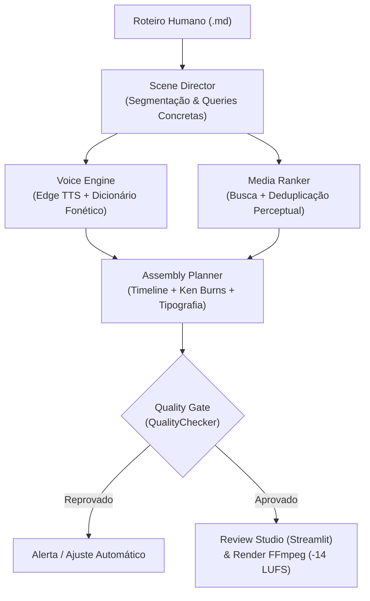

# 🤖 GUIA DE AGENTES — FÁBRICA DE SHORTS / PROJETO MERCADORIA

> **Documento de Orientação para Agentes Autônomos de IA (Antigravity, Cursor, Claude Code, Aider, OpenHands, orchestrator).**  
> *Leia este documento ANTES de inspecionar outros arquivos. Ele foi desenhado para economizar tokens e fornecer um mapa mental exato do repositório.*

---

## ⚡ 1. Mapa de Roteamento Rápido (Economize Tokens Aqui!)

**NÃO faça buscas globais nem abra múltiplos arquivos grandes.** Use esta tabela para ir direto ao arquivo responsável pela sua tarefa:

| Objetivo da Tarefa | Arquivo(s) Exato(s) para Abrir | O que NÃO precisa abrir |
| :--- | :--- | :--- |
| **Segmentação de roteiro / prompts / atos** | `app/services/director/scene_director.py`<br>`app/services/director/schemas.py` | `task.py`, `video.py`, `material.py` |
| **Busca de vídeos, deduplicação, ranking** | `app/services/media_ranker/deduplicator.py`<br>`app/services/media_ranker/media_searcher.py`<br>`app/services/media_ranker/candidate_builder.py` | `material.py` (tem 120KB!), `video.py` |
| **Posicionamento de texto / legendas / Safe Area** | `app/services/graphics/typography_engine.py`<br>`app/services/graphics/theme.py` | `subtitle.py`, `webui/Main.py` |
| **Efeito Ken Burns / Animação de fotos estáticas** | `app/services/utils/ken_burns.py` | `video.py` |
| **Masterização de áudio / Ducking / Loudness (-14 LUFS)** | `app/services/audio/mastering.py` | `voice.py` (tem 150KB!), `bgm.py` |
| **Timeline de montagem / Quality Gate** | `app/services/assembly/planner.py`<br>`app/services/assembly/quality_checker.py`<br>`app/services/assembly/schemas.py` | `video_project.py`, `task.py` |
| **Pipeline integrado / Orquestração Fábrica** | `app/services/factory.py` | `main.py`, `app/asgi.py` |
| **Review Studio / Interface Humana (Streamlit)** | `webui/pages/1_🎬_Scene_Review.py`<br>`app/services/review/review_manager.py` | `webui/Main.py` (tem 360KB!) |
| **Pronúncia e Fonemas PT-BR** | `app/services/editorial/pronunciation.py` | `voice.py` |

---

## 🏛️ 2. Identidade do Projeto & Visão Arquitetural

A **Fábrica de Shorts** (também conhecida como *Projeto Mercadoria*) é uma plataforma de automação de ensaios audiovisuais verticais (60 a 90 segundos, proporção 9:16). 

O projeto opera em duas camadas:
1. **Camada Legada / Engine Base (MoneyPrinterTurbo v1.3.8):** Gerencia drivers de TTS, clientes de busca (Pexels, Pixabay), configurações globais e integração bruta com FFmpeg.
2. **Camada Editorial Inteligente (`app/services/`):** Adiciona direção semântica, montagem em 5 atos, deduplicação perceptual, safe area vertical, masterização EBU R128 e Quality Gate pré-render.



---

## 🚨 3. As 6 Regras de Ouro Inegociáveis (Hard Constraints)

Qualquer agente que editar código neste repositório **DEVE** respeitar estas regras. Modificações que violem estas restrições quebram os testes e a integridade editorial:

1. **Narração é Sagrada (Zero Alucinação):**
   - O campo `narration` de cada cena é uma fatia literal do roteiro humano aprovado.
   - O agente **NUNCA** deve reescrever, abreviar, resumir ou alterar pontuação da narração.
   - O validador `scene_validator.py` confere se a junção de todas as narrações é idêntica ao roteiro original.

2. **Proibição de Buscas Abstratas:**
   - **NUNCA** busque termos conceituais: `"economy"`, `"market"`, `"wealth"`, `"value"`, `"capitalism"`, `"supply chain"`.
   - **SEMPRE** busque objetos e ações físicas tangíveis: `"t-shirt price tag"`, `"garment factory sewing machine"`, `"lithium mining truck"`.

3. **Zero Repetições Visuais Involuntárias:**
   - O mesmo asset (`asset_id`) **NÃO PODE** ser reutilizado no mesmo vídeo.
   - Limite por autor: máximo de 2 mídias do mesmo criador em todo o vídeo (elimina a "síndrome dos cadeados").
   - *Exceção única:* Quando a cena tiver `intentional_callback: str` apontando explicitamente para uma cena anterior.

4. **Respeito Estrito à Safe Area Vertical 9:16 (1080x1920):**
   - Margem Superior Proibida: Topo `< 250px` (reservado para status/menus de apps).
   - Margem Inferior Proibida: Base `> 1570px` (reservado para legendas de apps, like, share, perfil).
   - Margens Laterais: Mínimo de `60px` de cada borda (largura útil: `960px`).
   - Textos fora desses limites são sumariamente rejeitados pelo `QualityChecker`.

5. **Masterização de Áudio Padrão EBU R128 (-14.0 LUFS):**
   - A voz deve ser normalizada em **-14.0 LUFS integrados** (True Peak -1.0 dBFS).
   - A música de fundo (BGM) deve sofrer **ducking automático dinâmico (-14dB a -18dB)** sempre que a voz estiver falando, subindo suavemente nas pausas.

6. **Quality Gate Pré-Render Obrigatório:**
   - Nenhum vídeo deve ser enviado para render pesado FFmpeg sem aprovação de `QualityChecker.evaluate(plan)`.
   - Violações (`duplicate_assets > 0`, `text_safe_area_errors > 0`, `segments_without_visual > 0`) bloqueiam o render.

---

## 📁 4. Mapa da Estrutura de Pastas

```text
fabrica de bermudas/
├── AGENTS.md                  # ➔ VOCÊ ESTÁ AQUI (Guia mestre de entrada)
├── abrir_programa.sh          # Launcher que abre o Streamlit e navegador
├── demo_editorial.py          # Script de demonstração ponta a ponta
├── config.toml                # Configurações ativas de chaves e portas
├── config.example.toml        # Modelo de configuração
│
├── agents/                    # Hub detalhado de diretrizes dos agentes
│   ├── README.md              # Visão geral dos agentes
│   ├── PIPELINES_AND_GUIDELINES.md # Mapa detalhado de fluxos e schemas
│   ├── PIPELINE_WORKFLOW.md   # Diagramas de sequência
│   ├── 01_DIRECTOR_AGENT.md   # Decupagem e queries concretas
│   ├── 02_MEDIA_RANKER_AGENT.md # Deduplicação e ranking
│   ├── 03_TYPOGRAPHY_AGENT.md # 3 camadas tipográficas e Safe Area
│   ├── 04_AUDIO_MASTERING_AGENT.md # EBU R128 e Sidechain Ducking
│   └── 05_ASSEMBLY_QA_AGENT.md# AssemblyPlan e QualityChecker
│
├── app/                       # Código-fonte principal
│   ├── config/                # Módulos de configuração (MoneyPrinterTurbo)
│   ├── models/                # Schemas Pydantic legados e globais
│   ├── services/              # Serviços de negócio
│   │   ├── factory.py         # 🎬 ShortsFactory: orquestrador unificado
│   │   ├── director/          # Agente 01: SceneDirector, Schemas, Prompts
│   │   ├── media_ranker/      # Agente 02: Deduplicator, Searcher, Ranker
│   │   ├── graphics/          # Agente 03: TypographyEngine, Cards, Safe Area
│   │   ├── audio/             # Agente 04: Mastering, Loudness, Ducking
│   │   ├── assembly/          # Agente 05: AssemblyPlanner, QualityChecker
│   │   ├── editorial/         # Roteiros e dicionário de pronúncia
│   │   ├── review/            # Gerenciamento de rascunhos e aprovação humana
│   │   ├── utils/             # Ken Burns, helpers de ffmpeg
│   │   ├── voice.py           # Driver de EdgeTTS / ElevenLabs / etc.
│   │   └── video.py           # Compositor de vídeo FFmpeg legado
│   └── asgi.py                # Servidor FastAPI
│
├── webui/                     # Interface Streamlit
│   ├── Main.py                # Interface principal legada
│   └── pages/
│       ├── 1_🎬_Scene_Review.py    # Review Studio editorial
│       ├── 2_🎙️_Voice_Studio.py     # Estúdio de vozes
│       └── 3_📦_Batch_Production.py # Produção em lote
│
├── storage/                   # Diretório de dados dinâmicos (ignorado no git)
│   ├── scripts/               # Roteiros versionados (.md)
│   ├── projects/              # Planos de cena e planos de montagem (.json)
│   ├── media_cache/           # Vídeos e imagens baixados
│   └── audio_cache/           # Áudios gerados pelo TTS
│
└── test/                      # Testes automatizados (pytest)
    └── services/
        └── test_mercadoria_v02.py # Testes rápidos das regras editoriais
```

---

## 🧪 5. Comandos de Execução e Verificação

> [!TIP]
> **Economia de Tempo e Recursos:** A importação dos módulos completos da aplicação leva ~45s devido ao carregamento de bibliotecas de áudio/vídeo. Para validações rápidas de lógica, execute apenas os testes unitários sem chamadas de rede.

### 1. Teste Rápido (Unitário - Recomendado para Agentes)
Executa a validação de schemas, regras de deduplicação, timeline e QualityChecker em segundos:
```bash
.venv/bin/pytest test/services/test_mercadoria_v02.py -k "not test_shorts_factory_produces_assembly_plan"
```

### 2. Rodar a Demonstração Completa do Pipeline
Gera um rascunho com Storyboard HTML:
```bash
.venv/bin/python demo_editorial.py
```

### 3. Iniciar o Review Studio (Streamlit)
```bash
./abrir_programa.sh
# Ou diretamente:
.venv/bin/streamlit run webui/pages/1_🎬_Scene_Review.py
```

---

## 📦 6. Schemas e Contratos de Dados Resumidos

### `Scene` (`app/services/director/schemas.py`)
```python
class Scene(BaseModel):
    scene_id: str                      # Ex: "scene_001"
    narration: str                     # Fatia LITERAL do roteiro (NÃO MODIFICAR)
    intent: str                        # Intenção visual/editorial
    queries: list[str]                 # 3 a 5 buscas concretas em inglês
    narrative_function: str            # hook, example, joke, reveal, etc.
    narrative_phase: str               # aspiration, commodity, production, labor, reveal
    text_overlay: Optional[str]        # Texto gráfico de impacto
    text_level: str                    # "title", "emphasis", "caption"
    humor: bool                        # Se True, corte rápido (0.8s - 1.5s)
    intentional_callback: Optional[str]# Referência à cena anterior para repetição válida
```

### `AssemblyPlan` (`app/services/assembly/schemas.py`)
```python
class AssemblyPlan(BaseModel):
    project_id: str
    total_duration: float
    segments: list[AssemblySegment]
    quality_score: Optional[QualityScore]
```

### `QualityScore` (`app/services/assembly/schemas.py`)
```python
class QualityScore(BaseModel):
    passed: bool                       # True se todas as regras forem satisfeitas
    duplicate_assets: int              # DEVE ser 0 (exceto se is_callback=True)
    segments_without_visual: int       # DEVE ser 0
    text_safe_area_errors: int         # DEVE ser 0
    semantic_match_avg: float          # DEVE ser >= 0.60
    visual_diversity: float            # DEVE ser >= 0.30
```

---

## 🛡️ 7. Protocolo de Edição para Agentes

1. **Edições Pontuais e Cirúrgicas:** NUNCA substitua arquivos inteiros se a alteração for em apenas um método. Utilize substituições parciais.
2. **Respeite o Singleton e Injeção de Dependência:** Em `app/services/factory.py`, instâncias como `SceneDirector`, `MediaSearcher`, `AssemblyPlanner` e `QualityChecker` são instanciadas uma única vez e conectadas entre si. Mantenha essa coesão.
3. **Mantenha os Tipos Estritos:** Utilize anotações de tipo Python 3.11 (`list[str]`, `dict[str, Any]`, `Optional[T]`).
4. **Logs via Loguru:** Utilize `from loguru import logger` para registrar operações, alertas ou depurações.
5. **Consulte a Documentação Expandida:** Para especificações aprofundadas dos algoritmos e fórmulas matemáticas, leia [`agents/PIPELINES_AND_GUIDELINES.md`](file:///home/lucasregis/%C3%81rea%20de%20trabalho/Projetos/Backup/fabrica%20de%20bermudas/agents/PIPELINES_AND_GUIDELINES.md).
