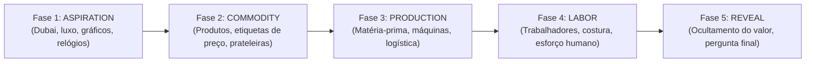

# 🎬 Agente 01: Scene Director (Diretor de Cenas)

**Localização no Código:** [app/services/director/](file:///home/lucasregis/%C3%81rea%20de%20trabalho/Projetos/Backup/fabrica%20de%20bermudas/app/services/director/)  
**Arquivos Chave:** [scene_director.py](file:///home/lucasregis/%C3%81rea%20de%20trabalho/Projetos/Backup/fabrica%20de%20bermudas/app/services/director/scene_director.py), [prompt_builder.py](file:///home/lucasregis/%C3%81rea%20de%20trabalho/Projetos/Backup/fabrica%20de%20bermudas/app/services/director/prompt_builder.py), [schemas.py](file:///home/lucasregis/%C3%81rea%20de%20trabalho/Projetos/Backup/fabrica%20de%20bermudas/app/services/director/schemas.py), [scene_validator.py](file:///home/lucasregis/%C3%81rea%20de%20trabalho/Projetos/Backup/fabrica%20de%20bermudas/app/services/director/scene_validator.py)

---

## 1. Missão do Agente

O **Scene Director** recebe um roteiro humano aprovado e o converte em uma partitura audiovisual (`ScenePlan`). Ele não é um escritor (não inventa texto de narração); ele é um **diretor de fotografia, montador e semioticista**.

Ele segmenta o texto frase por frase, classifica a função retórica de cada segmento, define a progressão estética do vídeo, extrai entidades concretas e constrói buscas visuais ultra-específicas.

---

## 2. Regra Absoluta de Integridade Literal

- O campo `narration` de cada cena **DEVE ser uma cópia exata** de um trecho do roteiro.
- É estritamente proibido resumir, parafrasear, corrigir pontuação ou omitir trechos.
- O validador [scene_validator.py](file:///home/lucasregis/%C3%81rea%20de%20trabalho/Projetos/Backup/fabrica%20de%20bermudas/app/services/director/scene_validator.py) confronta a soma de todas as narrações com o texto de entrada. Qualquer divergência dispara erro de integridade.

---

## 3. Classificação Retórica (`narrative_function`)

Cada cena deve receber obrigatoriamente uma das 10 funções abaixo:

| Função | Finalidade | Efeito Visual Esperado | Duração Típica |
| :--- | :--- | :--- | :---: |
| `hook` | Fisgar atenção nos primeiros 3 segundos | Imagem de alto impacto aspiracional ou contraste imediato | 2.0s – 3.0s |
| `setup` | Estabelecer a premissa ou o objeto | Objeto cotidiano em foco (ex: caneca, celular) | 2.5s – 4.0s |
| `example` | Fornecer caso concreto do mundo real | Preço na prateleira, produto em loja | 1.5s – 3.0s |
| `explanation`| Construir a linha lógica | Montagem didática sequencial (A → B → C) | 2.5s – 4.0s |
| `concept` | Definir ou abstrair uma relação | Cartela gráfica, número ou texto de destaque | 2.5s – 3.5s |
| `contrast` | Chocar duas realidades incompatíveis | Corte seco entre riqueza e produção pesada | 1.5s – 2.5s |
| `joke` | Alívio cômico seco e literal | Quebra rápida interpretando metáforas ao pé da letra | **0.8s – 1.5s** |
| `reveal` | Revelação do mecanismo oculto | Bastidores da produção, chão de fábrica | **3.5s – 5.0s** |
| `transition` | Conectar blocos de pensamento | Movimento dinâmico de câmera | 1.0s – 2.0s |
| `conclusion` | Fechamento reflexivo e provocação final | Silêncio, corte preto ou pergunta direta | 3.0s – 5.0s |

---

## 4. Progressão Visual em 5 Fases (`narrative_phase`)

Para evitar a monotonia estética, o vídeo deve migrar gradualmente de atmosfera:



---

## 5. Diretrizes Rígidas para Queries Visuais

### ❌ O que NUNCA fazer (Queries Abstratas)
- `"economy"`
- `"market"`
- `"wealth"`
- `"value"`
- `"capitalism"`
- `"supply chain"` (sempre traz cadeados e galpões genéricos vazios!)

### ✅ O que SEMPRE fazer (Queries Concretas e Literais)
- Frase: *"Uma camiseta custa oitenta reais."*  
  ➔ Queries: `["clothing price tag retail store", "tshirt display shopping mall", "clothes rack boutique"]`
- Frase: *"Antes dela chegar à loja, existiram algodão, máquina e costura."*  
  ➔ Queries: `["cotton field raw harvesting", "industrial textile spinning machine", "factory worker sewing t-shirt"]`
- Frase: *"O petróleo caiu."* (função: `joke`)  
  ➔ Queries: `["oil barrel falling dropped on ground literal", "crude oil container falling floor"]`

---

## 6. Contrato de Saída JSON do Scene Director

```json
{
  "scenes": [
    {
      "scene_id": "scene_001",
      "narration": "Quer entender como a economia funciona de verdade?",
      "intent": "Fisgar o espectador com imagem de riqueza clássica de finanças",
      "narrative_function": "hook",
      "narrative_phase": "aspiration",
      "entities": ["economia", "riqueza"],
      "visual_type": "stock_video",
      "queries": [
        "luxury business skyscrapers skyline dubai",
        "expensive sports car driving city",
        "stock market display board green"
      ],
      "preferred_motion": "lateral",
      "importance": 4,
      "text_overlay": "ECONOMIA REAL",
      "text_level": "title",
      "humor": false,
      "duration_hint": 3.0
    }
  ]
}
```
