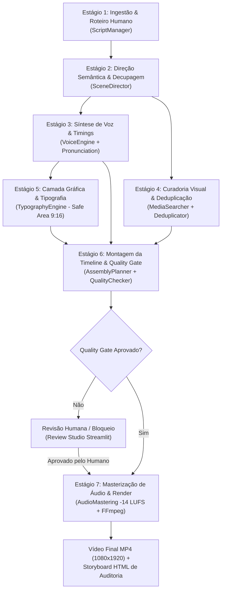

# 🗺️ MAPAS DE PIPELINES E DIRETRIZES TÉCNICAS

> **Documento de Referência Completa do Pipeline Audiovisual — Fábrica de Shorts / Projeto Mercadoria.**  
> *Consulte este mapa para entender exatamente o ciclo de vida dos dados, os contratos JSON entre agentes e as fórmulas de decisão matemática.*

---

## 📑 Índice Rápido
1. [Fluxo Geral dos 8 Estágios do Pipeline](#-1-fluxo-geral-dos-8-estágios-do-pipeline)
2. [Detalhamento Passo a Passo de Cada Estágio](#-2-detalhamento-passo-a-passo-de-cada-estágio)
3. [Contratos de Dados e Schemas JSON Oficiais](#-3-contratos-de-dados-e-schemas-json-oficiais)
4. [Algoritmo de Deduplicação e Ranqueamento Visual](#-4-algoritmo-de-deduplicação-e-ranqueamento-visual)
5. [Diretrizes de Tipografia e Safe Area 9:16](#-5-diretrizes-de-tipografia-e-safe-area-916)
6. [Diretrizes de Masterização de Áudio e Ducking](#-6-diretrizes-de-masterização-de-áudio-e-ducking)
7. [Quality Gate Pré-Render (QualityChecker)](#-7-quality-gate-pré-render-qualitychecker)
8. [Matriz de Resolução de Problemas (Economia de Tokens)](#-8-matriz-de-resolução-de-problemas-economia-de-tokens)

---

## 🔄 1. Fluxo Geral dos 8 Estágios do Pipeline

O pipeline processa um roteiro aprovado até o vídeo vertical final de alta retenção através de 8 etapas bem delimitadas:



---

## 🛠️ 2. Detalhamento Passo a Passo de Cada Estágio

### Estágio 1: Ingestão e Controle de Versão de Roteiro
- **Módulo:** `app/services/editorial/script_manager.py`
- **Entrada:** Texto em Markdown fornecido pelo roteirista humano.
- **Saída:** Arquivo persistido em `storage/scripts/<script_id>.md`.
- **Regra:** O roteiro humano é congelado. Nenhuma etapa subsequente pode alterar o texto da narração falada.

### Estágio 2: Direção Semântica e Decupagem Retórica
- **Módulos:** `app/services/director/scene_director.py`, `app/services/director/prompt_builder.py`
- **Entrada:** Texto bruto do roteiro.
- **Saída:** `ScenePlan` com lista ordenada de instâncias `Scene`.
- **Operações:**
  - Segmentação frase a frase;
  - Atribuição de função retórica (`hook`, `setup`, `example`, `explanation`, `concept`, `contrast`, `joke`, `reveal`, `transition`, `conclusion`);
  - Atribuição da fase dramática (`aspiration`, `commodity`, `production`, `labor`, `reveal`);
  - Geração de 3 a 5 queries em inglês descritivas e estritamente concretas.

### Estágio 3: Síntese de Voz e Alinhamento Fonético
- **Módulos:** `app/services/voice.py`, `app/services/editorial/pronunciation.py`
- **Entrada:** `narration` de cada cena.
- **Saída:** Arquivos `.mp3` calibrados por cena em `storage/projects/<script_id>/audio/`.
- **Operações:**
  - Aplicação de regras fonéticas do PT-BR (siglas, marcas, números);
  - Geração de áudio via Edge TTS (`pt-BR-AntonioNeural-Male` por padrão) ou ElevenLabs;
  - Extração de timestamps milimétricos para calcular `start` e `end` reais da cena.

### Estágio 4: Curadoria Visual, Busca e Deduplicação
- **Módulos:** `app/services/media_ranker/candidate_builder.py`, `deduplicator.py`, `media_searcher.py`
- **Entrada:** Queries e metadados visuais de cada cena.
- **Saída:** Cada cena enriquecida com `media_candidates` e `selected_media`.
- **Operações:**
  - Busca federada (Pexels, Pixabay, acervo local `SmartLibrary`);
  - Filtro técnico de resolução e orientação vertical;
  - Aplicação de penalidades por reuso de asset, repetição de autor ou saturação de categoria visual;
  - Respeito a `intentional_callback` (quando uma cena anterior é propositalmente revisitada).

### Estágio 5: Camada Gráfica e Validação de Safe Area
- **Módulos:** `app/services/graphics/typography_engine.py`, `theme.py`
- **Entrada:** `text_overlay`, `text_level` e dimensões de tela (1080x1920).
- **Saída:** Cartelas gráficas renderizadas em PNG transparente ou parâmetros para overlay FFmpeg.
- **Operações:**
  - Aplicação de 3 níveis tipográficos (`TITLE`, `EMPHASIS`, `CAPTION`);
  - Restrição rígida aos limites da Safe Area 9:16 (topo livre >= 250px, base livre >= 350px).

### Estágio 6: Montagem da Timeline e Quality Gate
- **Módulos:** `app/services/assembly/planner.py`, `quality_checker.py`, `schemas.py`
- **Entrada:** `ScenePlan` enriquecido com áudio e mídias.
- **Saída:** `AssemblyPlan` com segments detalhados e objeto `QualityScore`.
- **Operações:**
  - Cálculo de duração dinâmica (cenas de `joke`: 0.8s a 1.5s; `reveal`: 3.5s a 5.0s);
  - Avaliação de qualidade: duplicações, ausência de mídia, safe area, diversidade;
  - Se reprovado, trava a renderização e gera relatório com erros apontados.

### Estágio 7: Masterização de Áudio e Renderização FFmpeg
- **Módulos:** `app/services/audio/mastering.py`, `app/services/utils/ken_burns.py`, `factory.py`
- **Entrada:** `AssemblyPlan` aprovado.
- **Saída:** Vídeo final `.mp4` e Storyboard `.html`.
- **Operações:**
  - Aplicação de efeito Ken Burns (movimento cinematográfico) em imagens estáticas;
  - Filtro FFmpeg EBU R128 (`loudnorm=I=-14.0:TP=-1.0:LRA=7`) na faixa vocal;
  - Sidechain compress na trilha de fundo (`ducking` de -14dB a -18dB sob a fala);
  - Composição do timeline e codificação H.264 / AAC.

### Estágio 8: Review Studio e Intervenção Humana
- **Módulos:** `app/services/review/review_manager.py`, `webui/pages/1_🎬_Scene_Review.py`
- **Interface:** Streamlit.
- **Operações:**
  - Visualização de storyboard com thumbnails de cada cena;
  - Troca de mídia com 1 clique a partir dos 5 candidatos pré-ranqueados;
  - Botão de bloqueio de mídias (`block_asset`) para alimentar a lista negra;
  - Ajuste fino de texto em tela sem mexer no áudio.

---

## 📑 3. Contratos de Dados e Schemas JSON Oficiais

### 3.1. `ScenePlan` (`storage/projects/<script_id>/scenes.json`)
```json
{
  "script_id": "mercadoria_demo_01",
  "title": "Mercadoria: O Culto do Preço",
  "scenes": [
    {
      "scene_id": "scene_001",
      "narration": "Existe uma pergunta que quase ninguém faz sobre riqueza: de onde vem o valor das coisas?",
      "intent": "Fisgar a atenção questionando a origem do valor sobre imagens de riqueza moderna",
      "narrative_function": "hook",
      "narrative_phase": "aspiration",
      "entities": ["riqueza", "valor"],
      "visual_type": "stock_video",
      "queries": [
        "luxury business skyscrapers skyline dubai",
        "expensive wristwatch gold macro close up",
        "stock market electronic board ticker"
      ],
      "preferred_motion": "lateral",
      "importance": 5,
      "text_overlay": "DE ONDE VEM O VALOR?",
      "text_level": "title",
      "humor": false,
      "intentional_callback": null,
      "duration_hint": 3.0
    }
  ]
}
```

### 3.2. `AssemblyPlan` (`storage/projects/<script_id>/assembly_plan.json`)
```json
{
  "project_id": "mercadoria_demo_01",
  "total_duration": 64.8,
  "segments": [
    {
      "segment_id": "seg_001",
      "start": 0.0,
      "end": 3.2,
      "asset_id": "pexels_dubai_skyline_10293.mp4",
      "asset_type": "video",
      "asset_path": "/storage/media_cache/pexels_dubai_skyline_10293.mp4",
      "crop": "9:16",
      "overlay_text": "DE ONDE VEM O VALOR?",
      "text_level": "title",
      "transition": "cut",
      "purpose": "hook",
      "scene_ref": "scene_001",
      "is_callback": false
    }
  ],
  "quality_score": {
    "passed": true,
    "asset_count": 22,
    "duplicate_assets": 0,
    "semantic_match_avg": 0.86,
    "visual_diversity": 0.78,
    "text_safe_area_errors": 0,
    "low_resolution_count": 0,
    "segments_without_visual": 0
  }
}
```

---

## 🔍 4. Algoritmo de Deduplicação e Ranqueamento Visual

O ranqueador de mídia calcula uma pontuação composta ponderada e aplica fatores de redução para evitar repetições:

### 4.1. Fórmula do Score Composto
$$\text{BaseScore} = (\text{ScoreSemântico} \times 0.50) + (\text{QualidadeTécnica} \times 0.25) + (\text{BônusDiversidade} \times 0.25)$$
$$\text{FinalScore} = \text{BaseScore} \times \text{PenalidadeDeduplicação}$$

### 4.2. Matriz de Penalidades do `MediaDeduplicator`
| Condição do Asset | Multiplicador | Efeito |
| :--- | :---: | :--- |
| **Asset Novo (primeira ocorrência)** | $\times 1.00$ | Sem penalidade |
| **Reutilização idêntica (`asset_id` já usado no vídeo)** | $\times 0.10$ | Praticamente descartado da seleção automática |
| **Mesma categoria temática consecutiva** | $\times 0.50$ | Desencoraja vídeos similares em sequência |
| **Autor já utilizado 2 vezes no vídeo** | $\times 0.20$ | Impede monopólio de um único criador (ex: cadeados) |
| **Asset na Lista Negra (`blocked_assets`)** | $\times 0.00$ | Eliminado imediatamente |
| **Retorno Narrativo Explícito (`intentional_callback`)** | $\times 1.00$ ($Score \ge 0.95$) | Penalidades ignoradas propositalmente |

---

## 🔤 5. Diretrizes de Tipografia e Safe Area 9:16

### 5.1. Mapa Visual da Safe Area Vertical (1080 x 1920)

```text
       0 px ┌──────────────────────────────────────────────┐
            │        ZONA DE RISCO TOPO (250 px)           │ ➔ Menus do TikTok/Reels, busca, som
     250 px ├──────────────────────────────────────────────┤
            │                                              │
            │                  SAFE AREA                   │
            │                                              │
            │   Margem esquerda: 60 px                     │
            │   Margem direita:  60 px                     │
            │   Largura útil central: 960 px               │
            │                                              │
            │   Y Mínimo de Texto: 250 px                  │
            │   Y Máximo de Texto: 1570 px                 │
            │                                              │
    1570 px ├──────────────────────────────────────────────┤
            │        ZONA DE RISCO BASE (350 px)           │ ➔ Perfil, legenda do post, botões laterais
    1920 px └──────────────────────────────────────────────┘   (like, comentário, compartilhar)
```

### 5.2. Níveis Tipográficos Oficiais
| Nível | Tamanho da Fonte | Formatação | Uso Recomendado |
| :--- | :---: | :--- | :--- |
| `TITLE` | **64pt – 96pt** | Caixa Alta, Peso Heavy, Caixa de Alto Contraste | Impacto inicial, perguntas, choque de preços |
| `EMPHASIS` | **42pt – 56pt** | Semi-Bold, Fundo com realce colorido | Frases-chave, antíteses, ideias centrais |
| `CAPTION` | **28pt – 36pt** | Regular/Medium, Fundo escuro semi-transparente | Acompanhamento do áudio falado da narração |

---

## 🎙️ 6. Diretrizes de Masterização de Áudio e Ducking

### 6.1. Calibração EBU R128
O pipeline adota os parâmetros recomendados para consumo em fones de ouvido e alto-falantes de smartphones:
- **Integrated Loudness ($I$):** `-14.0 LUFS` (com tolerância máxima de $\pm 0.5$ LUFS).
- **True Peak ($TP$):** `-1.0 dBFS` (evita distorção inter-amostra na compressão AAC).
- **Loudness Range ($LRA$):** `7.0 LU` (mantém voz nivelada sem variação excessiva de volume).

### 6.2. Sidechain Ducking de Música de Fundo
- Quando a voz começa a falar: o volume da música é reduzido em **-14 dB a -18 dB** com tempo de ataque de **50ms**.
- Nas pausas entre frases: o volume da música sobe gradualmente em **+6 dB a +8 dB** com tempo de release de **300ms**, sustentando o ritmo dramático.

---

## 🛡️ 7. Quality Gate Pré-Render (QualityChecker)

O `QualityChecker` em `app/services/assembly/quality_checker.py` audita o plano antes de gastar recursos de GPU/CPU no FFmpeg.

| Regra de Qualidade | Limite Permitido | Ação em Caso de Violação |
| :--- | :---: | :--- |
| **Assets Duplicados Involuntários** | `duplicate_assets == 0` | **Bloqueia render:** Alerta erro de repetição |
| **Segmentos sem Mídia Visual** | `segments_without_visual == 0` | **Bloqueia render:** Alerta mídia faltante |
| **Violação de Safe Area de Texto** | `text_safe_area_errors == 0` | **Bloqueia render:** Texto reposicionado ou rejeitado |
| **Score Semântico Médio** | `semantic_match_avg >= 0.60` | Alerta de baixa coerência |
| **Diversidade Visual do Vídeo** | `visual_diversity >= 0.30` | Alerta de monotonia (ex: 100% de fotos ou mesmo estilo) |

---

## ⚡ 8. Matriz de Resolução de Problemas (Economia de Tokens)

Quando precisar alterar um comportamento específico, consulte diretamente o ponto exato nesta matriz:

| Sintoma / Necessidade | Onde Modificar | Função / Linha Chave | Teste de Validação |
| :--- | :--- | :--- | :--- |
| **Ajustar queries automáticas geradas pela IA** | `app/services/director/prompt_builder.py` | `build_scene_prompt()` | `.venv/bin/pytest test/services/test_mercadoria_v02.py -k "test_scene_schema_extension"` |
| **Alterar penalidades de repetição de imagem** | `app/services/media_ranker/deduplicator.py` | `calculate_penalty()` | `.venv/bin/pytest test/services/test_mercadoria_v02.py -k "test_deduplicator"` |
| **Modificar limites de Safe Area (Top/Bottom)** | `app/services/graphics/typography_engine.py` | `SAFE_TOP_PX`, `SAFE_BOTTOM_PX` | `.venv/bin/pytest test/services/test_mercadoria_v02.py -k "test_quality_checker"` |
| **Ajustar volume de ducking da trilha sonora** | `app/services/audio/mastering.py` | `apply_ducking()` | `.venv/bin/python -c "import app.services.audio.mastering"` |
| **Adicionar novas regras ao Quality Gate** | `app/services/assembly/quality_checker.py` | `QualityChecker.evaluate()` | `.venv/bin/pytest test/services/test_mercadoria_v02.py -k "test_quality_checker"` |
| **Adicionar palavras com pronúncia especial** | `app/services/editorial/pronunciation.py` | `PRONUNCIATION_DICT` | `.venv/bin/pytest test/services/test_mercadoria_v02.py` |
| **Alterar timings de transição e cortes** | `app/services/assembly/planner.py` | `AssemblyPlanner.create_plan()` | `.venv/bin/pytest test/services/test_mercadoria_v02.py -k "test_assembly_planner"` |
