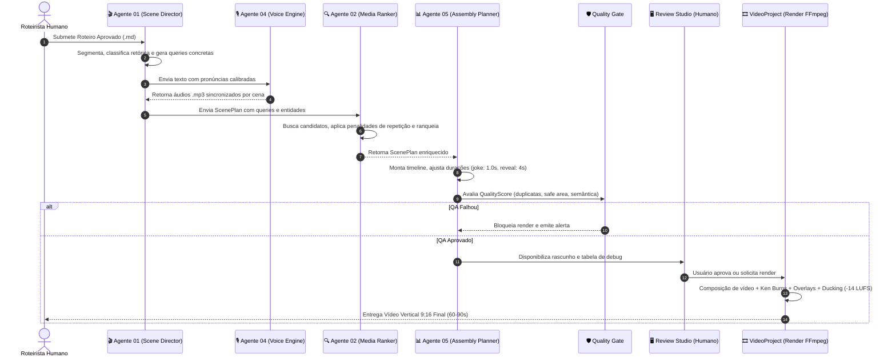

# 🔄 Pipeline Workflow: Da Ideia ao Vídeo Final

Este documento descreve o fluxo de dados completo e o protocolo de execução da **Fábrica de Shorts / Projeto Mercadoria**.

---

## 1. Diagrama de Fluxo Ponta a Ponta



---

## 2. Contratos de Dados entre Etapas

### Etapa 1 ➔ 2: Entrada do Roteiro
- Arquivo: `storage/scripts/<script_id>.md`
- Texto puro de narração humana aprovada, sem alucinações.

### Etapa 2 ➔ 3: `ScenePlan` (`storage/projects/<script_id>/scenes.json`)
- Cada cena contém:
  - `scene_id`: Identificador sequencial (`scene_001`, `scene_002`...).
  - `narration`: Fatia literal do roteiro.
  - `narrative_function`: Função retórica (`hook`, `example`, `joke`, `reveal`...).
  - `narrative_phase`: Fase da progressão estética (`aspiration`, `commodity`, `production`...).
  - `entities`: Lista de objetos reais citados (`["camiseta", "etiqueta", "fábrica"]`).
  - `queries`: 3 a 5 termos de busca em inglês descritivos e concretos.
  - `text_overlay` e `text_level`: Texto em destaque na tela (`TITLE`, `EMPHASIS`).
  - `humor`: Flag indicando alívio cômico literal rápido.

### Etapa 3 ➔ 4: `AssemblyPlan` (`storage/projects/<script_id>/assembly_plan.json`)
- Timeline exata de cortes:
  - `start` / `end` em segundos.
  - `asset_path` e `asset_type` (`video`, `photo`, `graphic`, `gif`).
  - `transition` (`cut`, `fade`).
  - `quality_score`: Objeto com métricas consolidadas.

---

## 3. Comandos Úteis de Execução e Teste

### Executar a Suite de Testes do Pipeline
```bash
.venv/bin/pytest test/services/test_mercadoria_v02.py -v
```

### Rodar o Review Studio (Streamlit)
```bash
.venv/bin/streamlit run webui/pages/1_🎬_Scene_Review.py
```

### Gerar um Rascunho via ShortsFactory em Python
```python
from app.services.factory import ShortsFactory

factory = ShortsFactory()
res = factory.produce_draft(
    script_id="mercadoria_teste",
    script_text="Uma camiseta custa oitenta reais.\nMas antes da loja existiram algodão e fábrica.",
    brand_style="editorial"
)
print("Vídeo renderizado:", res["video_path"])
print("Qualidade:", res["quality_score"])
```
